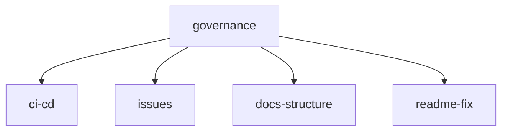

# Plan: Estructura P1 — omnigramatekh

## Major Components

| Module         | Files/Directories                                                                                       | Type                   |
| -------------- | ------------------------------------------------------------------------------------------------------- | ---------------------- |
| governance     | LICENSE, CHANGELOG.md, SECURITY.md, CONTRIBUTING.md, AGENTS.md, ARCHITECTURE.md, Makefile, .env.example | New files              |
| ci-cd          | .github/workflows/ci.yml, .github/CODEOWNERS, .github/renovate.json, .github/PULL_REQUEST_TEMPLATE.md   | New files + dir        |
| issues         | .github/ISSUE_TEMPLATE/bug.yml, .github/ISSUE_TEMPLATE/feature.yml                                      | New files + dir        |
| docs-structure | docs/, docs/architecture/, docs/guides/, docs/runbooks/, docs/README.md                                 | New directories + file |
| readme-fix     | README.md (add section)                                                                                 | Modify existing        |

## Dependencies & Build Order

- **governance** (no deps) → puede paralelizarse internamente
- **ci-cd, issues, docs-structure, readme-fix** dependen de governance (estructura base .github/, docs/)
- **readme-fix** es independiente pero trivial, ir al final

## Risks

| Risk                                                                 | Mitigation                                                                |
| -------------------------------------------------------------------- | ------------------------------------------------------------------------- |
| AGENTS.md/ARCHITECTURE.md requieren contexto de proyecto             | Usar AGENTS.md operador como base; ARCHITECTURE.md describe estado actual |
| CI workflow debe ser compatible con stack híbrido (HTML/Node/LinkML) | Workflow minimal: lint + test + validate estructura                       |
| Renovate config debe coincidir con package.json existente            | Basar en package.json actual (solo npm)                                   |
| CODEOWNERS depende de decisión organizativa                          | Definir antes de escribir; default @alexendros                            |

## Parallel vs Sequential

**Secuencial (orden obligatorio):**

1. governance (8 archivos) — base para directorios .github/, docs/
2. ci-cd + issues + docs-structure (pueden paralelizarse entre sí tras governance)
3. readme-fix (trivial, último)

**Paralelizable dentro de governance:** Los 8 archivos son independientes.

## Verification Checkpoints

| Checkpoint                   | Command                                                                                      | Expected                                              |
| ---------------------------- | -------------------------------------------------------------------------------------------- | ----------------------------------------------------- |
| CP1: governance completo     | `bash /home/alexendros/.pi/agent/skills/project-status/scripts/check-product-structure.sh .` | Solo faltan ci-cd, issues, docs-structure, readme-fix |
| CP2: ci-cd + issues completo | `bash /home/alexendros/.pi/agent/skills/project-status/scripts/check-product-structure.sh .` | Solo faltan docs-structure, readme-fix                |
| CP3: docs-structure completo | `bash /home/alexendros/.pi/agent/skills/project-status/scripts/check-product-structure.sh .` | Solo falta readme-fix                                 |
| CP4: Todo completo           | `bash /home/alexendros/.pi/agent/skills/project-status/scripts/check-product-structure.sh .` | **Exit 0, 0 errores P1**                              |
| CP5: CI válido               | `actionlint .github/workflows/ci.yml`                                                        | Sin errores                                           |
| CP6: Formato                 | `npx prettier --check .`                                                                     | Pasa                                                  |
| CP7: Tests existentes        | `npm test`                                                                                   | Pasa (no regresiones)                                 |

## Role Routing

| Module         | Implementation Roles                                                             | Test Surfaces               |
| -------------- | -------------------------------------------------------------------------------- | --------------------------- |
| governance     | role-linux (packaging, Makefile), role-back (AGENTS.md, ARCHITECTURE.md context) | check-product-structure.sh  |
| ci-cd          | role-linux (GitHub Actions, renovate), role-back (CI workflow)                   | actionlint, workflow syntax |
| issues         | role-linux (GitHub templates)                                                    | check-product-structure.sh  |
| docs-structure | role-linux (doc structure)                                                       | check-product-structure.sh  |
| readme-fix     | role-clean-code (Markdown style)                                                 | prettier, visual check      |

## Estimated Effort

| Module         | Size | Notes                                              |
| -------------- | ---- | -------------------------------------------------- |
| governance     | M    | 8 archivos, algunos requieren contenido específico |
| ci-cd          | S    | 4 archivos, plantillas estándar                    |
| issues         | XS   | 2 plantillas estándar                              |
| docs-structure | XS   | 5 items,mostly mkdir + README stub                 |
| readme-fix     | XS   | 1 sección en archivo existente                     |

**Total estimado**: ~M (2-3 sesiones enfocadas)
